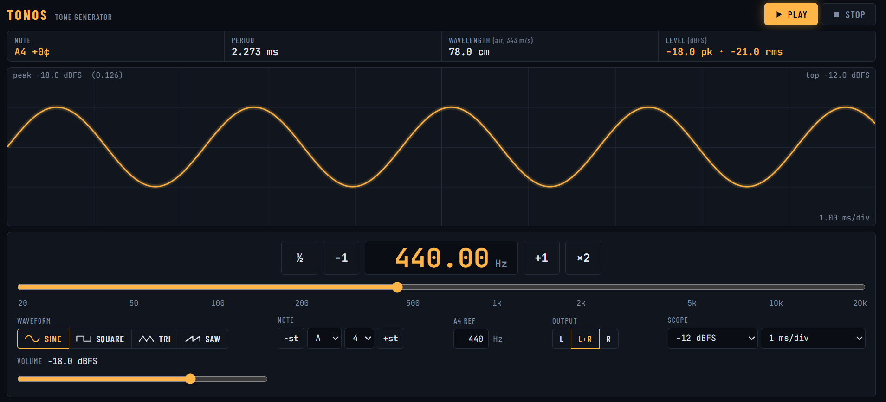

  

# TONOS

A browser-based tone generator with a live oscilloscope, for desktop and mobile. Plain HTML, CSS and JavaScript with no dependencies or build step.

**Live:** https://theogal.github.io/tonos/

## Screenshots

  

### disclaimer
Im into web developing the last 10 years but this app was 100% vibe-coded with Claude - I simply inspected the code afterwards.

## Features

- **Waveforms:** sine, square, triangle and sawtooth. They're band-limited, so there's no aliasing at any frequency.
- **Frequency control:** type a value, drag the log slider (20 Hz – 20 kHz), step ±1 Hz (hold to repeat) or jump an octave with ½ and ×2. Arrow keys in the field step 1 Hz, with Shift for 10 Hz and Alt for 0.1 Hz.
- **Note picker:** choose a note and octave or step by semitones, with an adjustable A4 reference (400–480 Hz).
- **Volume in dBFS:** exact output level, with clean fade-in and fade-out so there are no clicks.
- **Output channel:** left, right or both. Handy for checking speaker wiring.
- **Readouts:** nearest note with cents, period, wavelength in air, and measured peak and RMS level while playing.
- **Oscilloscope:** a stable, triggered trace with fixed vertical range (0 to −40 dBFS) and time base (10 µs/div to 50 ms/div), or auto modes.
- **Keyboard:** Space toggles play and stop.

### Anti-clip protection

The browser's square, triangle and sawtooth waves are band-limited, which keeps them free of aliasing. Their peaks can overshoot the nominal level by up to about 1 dB, depending on frequency.

Tonos trims the output just enough to prevent cliping. The volume slider is a hard ceiling: even at 0 dBFS, nothing clips. When a trim is active, the volume label shows it, e.g. `anti-clip −0.7 dB`.

### Oscilloscope

The scope works like a real one. The **range** sets the level at the top edge, so turning the volume down makes the trace smaller. The **time base** sets how much time the screen spans (10 divisions), so changing the frequency shows more or fewer cycles.

When there are fewer samples than pixels (high frequencies), the trace is reconstructed with sinc interpolation, the way your sound card's converter outputs it, rather than joining samples with straight lines. When many cycles share one pixel, it's drawn as a solid band at the true peak level, as on a digital scope.

### Defaults

The startup settings live in the `DEF` object at the top of `app.js`. Your last-used settings are saved in the browser and override them.

## How to host it

[Download the latest release](https://github.com/TheoGal/tonos/releases/latest), unzip it and place the `tonos` folder on your server. Any static web server works.

**License** MIT - do whatever you like with it
